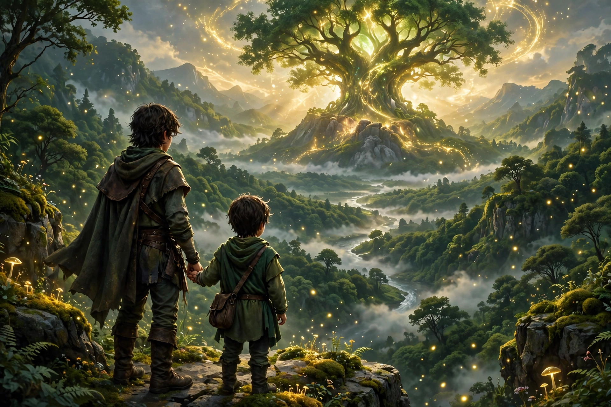

# 🌲 Brothers: A Tale of Two Sons — Story Website & Quiz Game

**Project 3: Design & Implementation of a Story-Based Game Website**

This website tells the **real story** of *Brothers: A Tale of Two Sons* (Starbreeze Studios) —
Naia and Naiee, their dying father, and the Water of Life — and turns that story into a
**chapter-wise quiz game**.



## 🔗 Live Demo

After GitHub Pages is enabled (see *Deploy* below):

**https://sheikhmuhammadtanbin47-a11y.github.io/brothers-of-the-valley/**

## 📖 The Real Story (summary)

Naiee, the younger brother, watched his mother drown at sea and fears water ever after.
When their father falls deathly ill, the village doctor says the only cure is the Water
from the **Tree of Life**. On the journey the brothers free a troll's wife from a cage in
the evil trolls' cave (Naiee steals the key), save a man in the woods, aid an inventor,
free a wounded griffin, cross the land of dead giants, rescue a girl from sacrifice —
who reveals herself as a monstrous **spider** and fatally wounds Naia. Naiee climbs the
Tree alone, finds Naia dead, buries him, swims home past his fear, and saves his father.
Father and son end the tale mourning at two tombstones: the mother's and Naia's.

## 🎮 The Quiz Game — Rules

- **30 questions per game**, chapter-wise: 6 chapters × 5 questions
- Questions are only about the story: what the brothers **saw, did, and what happened to them**
- **Question bank of 42** (7 per chapter). Each game randomly draws 5 per chapter,
  shuffles question order and shuffles the answer options — **a different set every replay**
- A short **story recap is shown before each chapter's questions**
- **Live % on screen after every question**: progress %, score %, correct count, points
- **Scoring: only correct answers count** — +10 points each, maximum **300 points**
- Wrong answer → 0 points, the correct answer is shown, and you **skip to the next question**
- Any question can also be **skipped** before answering (0 points)
- **Final result**: total points, correct / 30, wrong, skipped, final %, a grade title,
  and a **chapter-by-chapter % breakdown**. Best score is saved (localStorage)

## ▶️ How to Run

### VS Code (recommended)

1. Extract the ZIP / clone the repo.
2. VS Code → `File` → `Open Folder...` → select `brothers-of-the-valley`.
3. Install the **Live Server** extension (Ritwick Dey) — recommended automatically by `.vscode/extensions.json`.
4. Right-click `index.html` → **Open with Live Server** → plays at `http://127.0.0.1:5500/`.

Or simply double-click `index.html` — keep `hero-cover.webp` in the same folder.

## 🚀 Deploy — GitHub Pages (free)

1. Create a **Public** repository named exactly `brothers-of-the-valley`.
2. Upload `index.html`, `hero-cover.webp`, all five `game-*.jpg` pictures, `README.md` → **Commit changes**.
3. Repo **Settings → Pages** → Source: **Deploy from a branch**, Branch: **main**, Folder: **/ (root)** → **Save**.
4. Live in 1–2 minutes at the link above.

## 🛠️ Tech Stack

HTML5 • CSS3 (variables, Grid/Flexbox, responsive) • Vanilla JavaScript
(quiz engine, Fisher-Yates shuffle randomisation, scoring state, localStorage)

## 📁 Structure

```
brothers-of-the-valley/
├── index.html         ← website + quiz game (all-in-one)
├── hero-cover.webp    ← original cover artwork
├── game-prologue.jpg / game-village.jpg / game-troll.jpg / game-troll-remake.jpg / game-cliff.jpg  ← real gameplay screenshots from the original game & Remake (© Starbreeze / 505 Games, educational use)
├── README.md
└── .vscode/extensions.json
```

## 🎓 Project Info

- **Project 3** — Design & Implementation of a Story-Based Game Website
- **Reference design:** brothersthegame.com
- **Story content:** the real, published story of *Brothers: A Tale of Two Sons* (summarised for study; the game has one fixed ending — Naia dies, the father lives)
